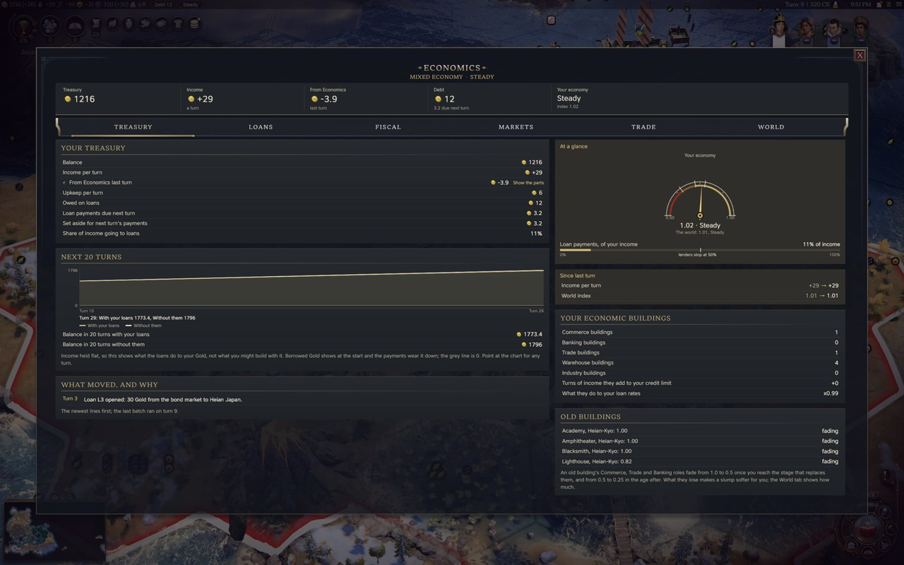
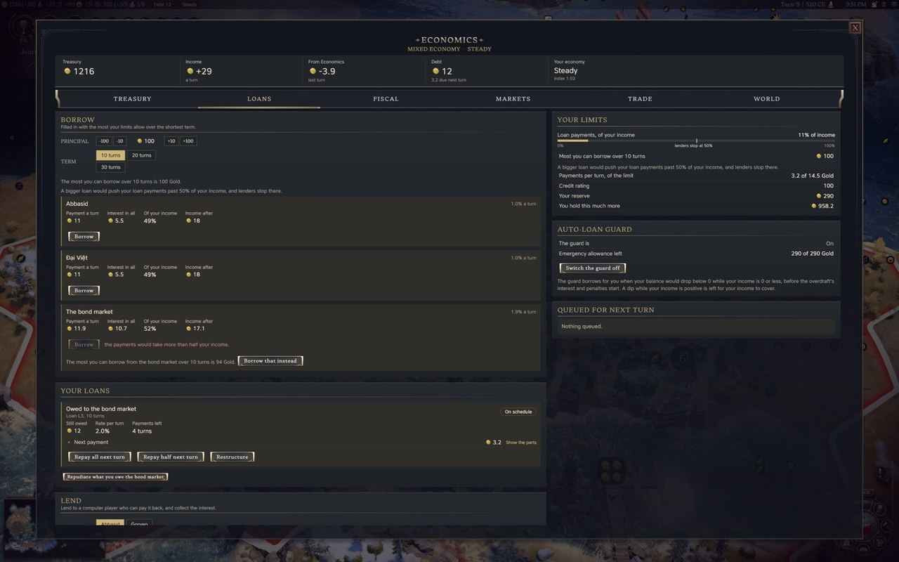
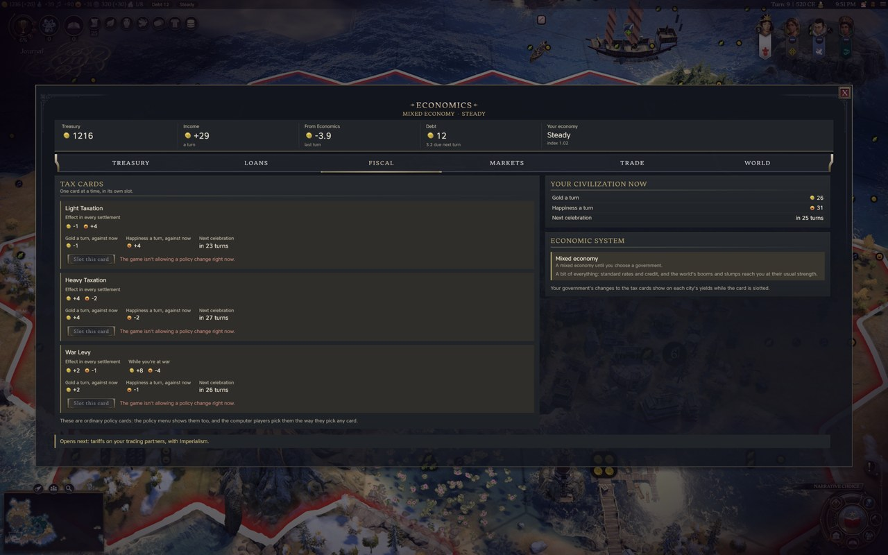
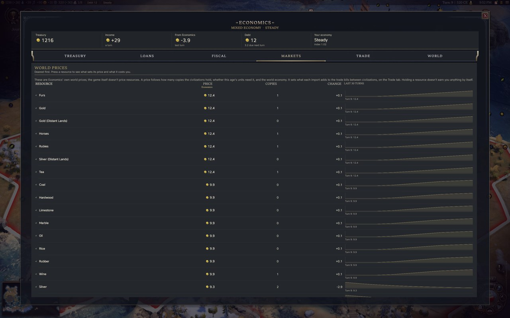
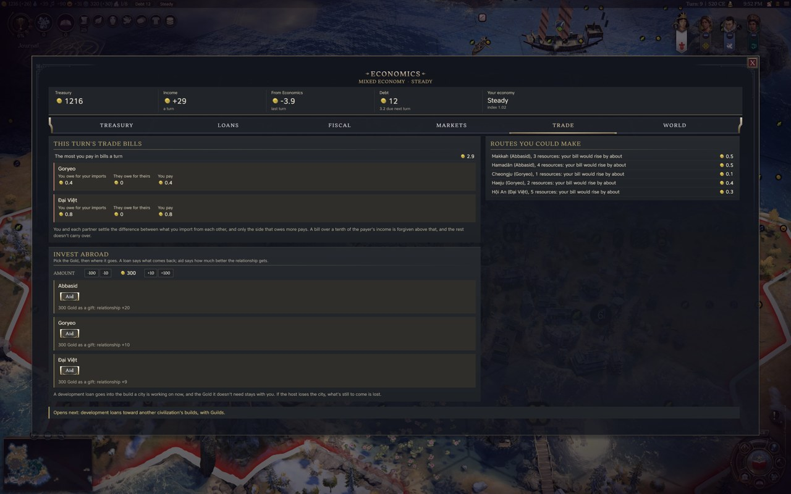
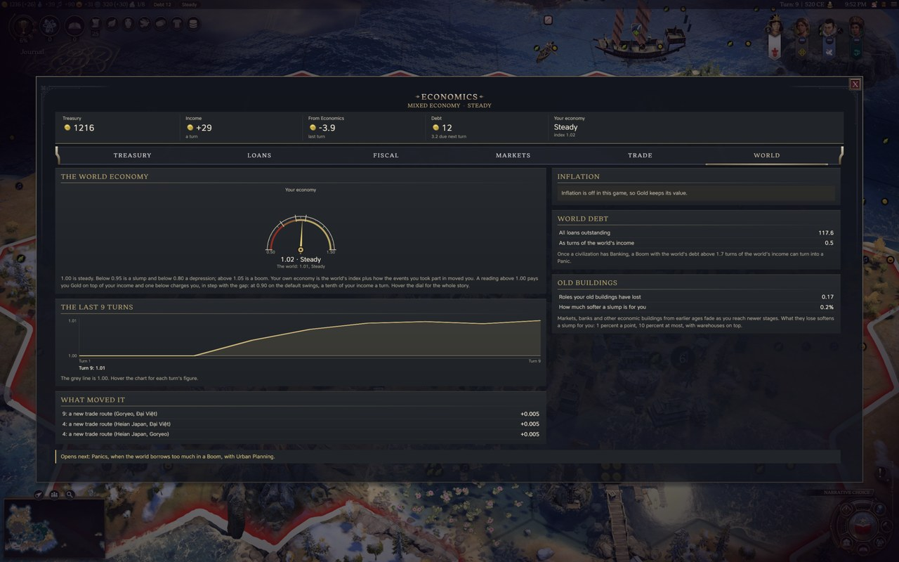
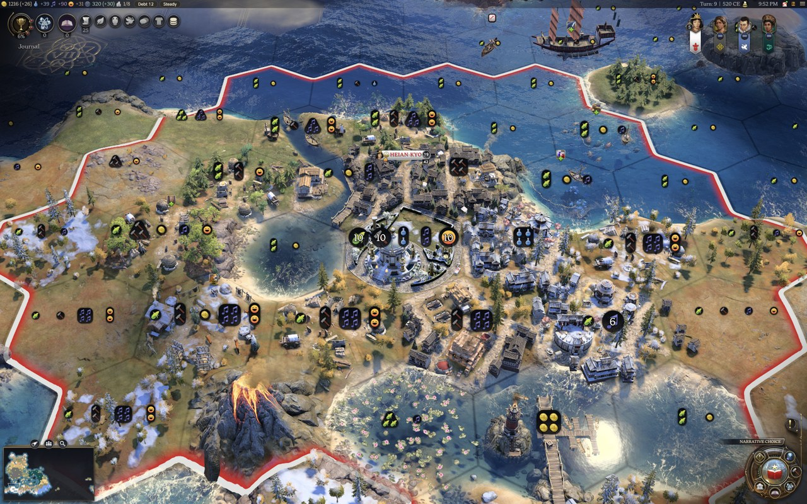
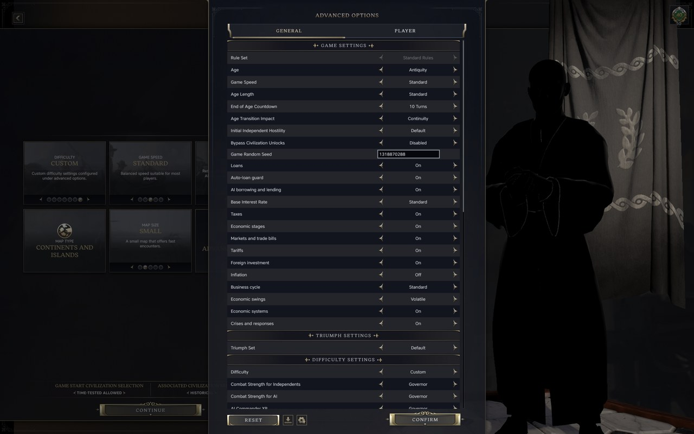

# Economics

A Civilization VII mod that gives Gold an economy: loans, debt that can run below zero, tax cards, world prices and
trade bills, investment and aid, a business cycle with crises, inflation, and an economic system for each government.
The computer players use them too. In development; what has been seen working in test games
is in [docs/verification-runs.md](docs/verification-runs.md), and the design is in [docs/DESIGN.md](docs/DESIGN.md).

## What it does

You can borrow from other civilizations or from a bond market and pay it back from what the Gold brings in, lend to a
neighbour who's short and collect the interest, and set a tax level as a policy card. A missed payment costs you;
three in a row is default; and you can repudiate a debt outright, keep the Gold, and pay in credit rating and goodwill
instead. When your Gold runs out, what you owe keeps being paid from an overdraft, and a treasury below zero costs you
more each turn you leave it there: unhappy settlements, dearer purchases, units disbanded, buildings shut down. You
can pay your way out or declare bankruptcy.

Resources get a world price, and the civilizations you trade with settle the difference in what you import from each
other every turn; you can tariff a partner, or put Gold into a neighbour's build or treasury and collect a return. Wars,
disasters and defaults pull the world's economy into slumps and peace and growing income lift it into booms; a deep
slump opens a crisis with responses to choose from, your government sets how your own economy runs, and the markets and
banks of an earlier age fade as newer ones take over.

## The computer players

The computer players work under the same numbers as you. They borrow when they're short and to fund a build, lend when
they're flush, repay early when they can, restructure an overdue loan, repudiate a debt to an enemy or a weaker rival
they dislike, make amends afterwards, invest in and aid the civilizations they have a stake in, set tariffs and answer
yours, take loans from their citizens in a civic market, pick crisis responses by what they can afford and what their
crisis needs, and weigh bankruptcy when they're deep below zero. Their debt payments and trade bills stand in their Gold
per turn as named lines, so the game's own AI plans its spending around them.

Where they differ from you, and why:

- They pick the tax cards in the game's own policy pass, which reads a card by its face value. The extra tax an
  economic system pays (a civic market's richer Light Taxation, for one) runs in the mod's scripts, which that pass
  can't see, so they pick the cards without counting that bonus.
- They choose governments by the game's own preferences. With Economic systems on, each civilization leans toward one
  government in each age, picked to suit it, so the computer players spread across the systems.
- Their choices run inside limits you don't have: they lend only when they hold more than 20 turns of income, keep
  one open investment in each host, give aid to a struggling partner at most once every 15 turns, borrow to build on
  10-turn terms with one build loan open, and weigh tariffs only against partners worth a third of their imports. The
  game's AI spends its Gold without knowing what it owes Economics, and the limits keep it from giving away Gold it
  needs.
- They repudiate a loan from their own citizens only when they're insolvent; you can at any time.

The AI setup option switches all of their Economics rules off at once.

## The Economics screen

Open it from its dock button. A strip above the tabs shows your treasury, income, what Economics moved last turn,
your debt and your economy's phase. The screen grows with your economy: in Antiquity it opens with the Treasury and
Fiscal tabs, and the Loans, Markets, Trade and World tabs appear as you reach the civics and techs that bring them in.
Each tab ends with a line naming what opens next. One notification a turn lists what Economics did to your Gold,
Influence and celebration meter, and a click on it opens the screen.

## Loans

The Loans tab shows what each lender offers you today: the rate per turn, the payment it would take and the interest
over the term. Pick a principal and a term of 10, 20 or 30 turns and the Gold lands at the start of your next turn.
Each turn after that the payment goes out by itself, interest plus a slice of the principal.

Your credit limit is set by your income (twelve turns of it, more with Commerce and Banking buildings), and the
payments on all your loans together can't pass half your income. If you ask for more than either limit allows, the
tab tells you the most that lender will lend over that term, and one click borrows that instead. If a payment comes
due and the Gold isn't there, even counting your overdraft, it's missed: the interest joins the debt, the rate rises a
step, you lose 5 Influence, and your standing with every lender slips for 20 turns. Pay once and the count resets;
miss three in a row and the loan is in default: the lender takes what it can from you each turn and won't lend again
this age.

An overdue loan can be restructured once: what's left spreads over ten new turns at the rate it has. Repudiation is
the other way out: you keep the Gold and stop paying, that lender closes to you for this age and the next and books a
grudge against you in the game's own grievances, each other civilization books "They repudiated a loan" against you,
and credit is dearer and scarcer for 40 turns. Ten turns later the lender will lend to you again at half again its
rate; repay that loan in full and the repudiation stops counting against your credit. The screen shows what each
choice costs before you confirm.

You can lend too. Pick a computer player that's short of Gold, your rate and term; it accepts if the rate is within a
fifth of what the bond market would charge it, its income is positive and the payments fit its limits. If it defaults
or repudiates, the loss is yours, so the form shows how close it is to doing that.

## Below zero

Your treasury can go below zero. Loan payments, trade bills, dividends, taxes and the other charges you owe keep being
paid from an overdraft that reaches 100 Gold or 10 turns of your income, whichever is more; past it a payment is
missed. Lending, aid, investing and buying production still need Gold in hand. While you're below zero you pay
interest on what you're overdrawn at twice the bond market's rate, capped at half your income, so as long as you're
earning Gold you pay the debt down. The game resets a negative treasury to 0 at the end of the turn; Economics charges
it back, so a debt stays a debt.

It costs you more the longer you stay there:

- Each settlement loses Happiness and everything you buy with Gold costs more, from 2 Happiness and 5% just under
  zero up to 15 and 30% past your overdraft. Your credit rating drops 2 points a turn.
- After two turns of warning your costliest unit is disbanded, then one every other turn, and from the seventh turn one
  a turn.
- From the eighth turn the buildings of your settlement with the highest building upkeep shut down: their upkeep
  drops to zero and they stop producing. Another settlement follows every other turn.
- Back above zero, the Happiness, prices and buildings return to normal.

The Treasury tab shows your overdraft, how much of it you've used and what it's costing you. If you'd rather start
over, declare bankruptcy from the same tab: your treasury goes back to 0, each of your loans is repudiated with the
usual costs, the civilizations you've met think less of you, and the bond market won't lend to you for 30 turns. You
can do it once every 30 turns.

A computer player below zero weighs the same choice once its warning turns are past. It sets what staying in debt
would cost it until the debt is paid (interest, unhappy settlements, dearer purchases, the units and buildings it would
lose) against what bankruptcy would (its credit rating, the grievances, a friend or a stronger civilization it owes),
and treats bankruptcy as a last resort. In test games a debt of up to about seven turns of its income was carried and
paid off, and nine turns or more declared at once. It weighs again if its income falls. You're told when one declares.

## The auto-loan guard

On by default, and switchable from the Loans tab. When your treasury would go below zero while your income is at or
below zero, the guard takes an emergency loan for the shortfall plus one turn of upkeep and tells you. Before
Moneylending it borrows from temple treasuries, later from the cheapest civilization or the bond market. It stops at a
cap of ten turns of your income and says so once; past that your overdraft takes over. A dip while your income is
positive is left for that income to lift.

## Taxes

Three policy cards, one of each per age: Light Taxation (-1 Gold in each settlement, and +6 Happiness in Antiquity, +4
in Exploration, +3 in Modern), Heavy Taxation (+4 Gold, -2 Happiness) and War Levy (+2 Gold, -1 Happiness in peace, +8
Gold and -4 Happiness while you're at war). The first civic of each age unlocks Light and grants one extra policy slot,
so a tax card doesn't push out a card you already hold; Heavy follows in Antiquity at Code of Laws and with the first
civic later, and War Levy comes with Currency in Antiquity and with the first civic later. They show in the policy
menu like any card, and the Fiscal tab slots or clears one for you, with how much your Gold and Happiness a turn would
change under each and when your next celebration would come.

## Your Gold per turn

What Economics charges and pays each turn stands in your capital as named lines the game counts in your Gold per
turn: "Debt service", "Loan repayments", "Trade bills", "Trade bills paid to you", "Economy costs" and "Economy
receipts". They show in City Details and the capital's Gold breakdown, so the top bar's Gold per turn is the one you'll
get, and the computer players see the same lines in their own income.

## Markets, trade bills and tariffs

Every resource has a world price, set by its class, how many copies the civilizations hold, and whether this age's
units need it (more so in wartime). The Markets tab lists the prices and their last 30 turns, and each resource opens
to show where its price comes from. Each pair of civilizations that trade settles the difference between what they
import from each other: 2.5 percent of the price of each copy a turn, up 10 percent for each Trade building in the
exporting city and down 10 percent for each in the importing one. Only the side that owes more pays, capped at a tenth
of its income; anything over the cap is forgiven.

From Imperialism you can set a tariff on the Fiscal tab: Low or High holds back 10 or 25 percent of what you owe the
civilizations you import from. A High tariff costs 1 relationship with each of them every five turns. The computer
players set Low against a big partner they pay more than they're paid and aren't friends with, and High against a big
partner they're Unfriendly with. They answer your tariff in kind two turns later, drop it when you do, and let theirs
go after 20 turns at peace with you or straight away once you're friends.

## Foreign investment and aid

From the Trade tab you can put Gold into another civilization. A development loan (from Guilds) goes into the build a
city is working on now, at the game's own purchase price for that build, and comes back at 5 percent a turn for 25
turns, 6 percent on an economic building. General investment (from Colonialism) goes into the treasury and its return
follows the host's income. Aid of either kind is a gift that buys goodwill: 1 relationship for each half a turn of the
receiver's income, up to 20 from one gift, and the line beside it says the number before you send. Loans raise the
relationship too, more slowly. Computer players invest in and aid the civilizations they have a stake in, and their
offers to you wait on the Trade tab for an answer. With Foreign investment on, a civilization that sends Military Aid
pays the 2 Gold a turn its target gets.

## The business cycle

The world has an economic index that starts at 1.00 and drifts back toward it between events. A war declared, a
settlement captured or razed, a disaster, the age's crisis, a default or a repudiated debt pulls it down; peace and
income growing faster than usual lift it. Your own economy is the world's index plus how the events you took part in
moved you, so the two sides of a war feel it most. Below 0.95 is a slump and below 0.80 a depression; above 1.05 is a
boom. A boom pays you Gold each turn and makes bond loans cheaper; a slump takes Gold and makes them dearer. On the
default Volatile swings a depression can take a third to half of your income for a few turns. Warehouses and old
economic buildings soften a slump. Once a civilization reaches Banking, a boom built on too much borrowing can turn
into a Panic: for five turns civilizations stop lending to each other and bond rates jump. The World tab shows the
index, your phase, what moved it and its last 30 turns.

## Crises and what you do about them

A deep slump, debts you can't meet, prices swinging hard or trade falling apart opens a crisis on the World tab. Each
civilization has the same shared responses, from public works and relief to a bank holiday or austerity, each with
its price and what it leaves behind. Your economic system leans toward some of them: a card it's built for says
"Institutional advantage" and costs a quarter less Gold, and one it resists says "Political opposition" and costs 10
Influence on top.

Some governments and ideologies also have answers only they can take. A Classical Republic can borrow from its
citizens as a public duty, a Plutocracy can charter its merchants or turn its debts into shares, a Democracy can run
New Deal programmes or regulate its banks, and a Fascist state can export its crisis into a war. These cost Influence.
They come in three kinds: a Measure is quick and small, a Gamble is fast with a catch written on the card, and a
Programme costs Influence and an administration charge every turn and has to run at least five turns. A Programme you
can't pay for keeps running for up to three turns short, at a rising premium. Once the crisis is over it's judged on
its own goal: meet it and it leaves a lasting institution; miss it or end it early and it leaves a mark of a different
kind. Each institution makes that path cheaper next time and the others a little dearer. The computer players weigh
the same cards.

With Partisans on, a deep Depression also counts toward partisan risings in your unhappiest settlements; Relief or New
Deal programmes ease it, and Austerity makes it worse in any crisis.

## Inflation

Off by default. When it's on, civilizations with Public debt share the bond market, and when they owe it a lot beside
the Gold they hold, their prices climb a little each turn: everything they buy with Gold costs more, and bond loans get
dearer. The capital shows it as "Inflation: prices +N%", the Treasury tab shows the rise the game charges, and prices
start over with each age. The computer players pay the same prices.

## Economic systems

Your government sets how your economy runs, and in the Modern age your ideology does. Despotism runs a palace economy:
Heavy Taxation and War Levy bring more Gold and your aid buys twice the goodwill, but you borrow only from other
civilizations. A Classical Republic runs a civic market: you can borrow from your own citizens, and the interest you
pay them comes back as celebration. Oligarchy is a merchant oligarchy with cheaper credit and bigger swings; Feudal
Monarchy is manorial, sheltered from the world's swings with taxes paid in kind; Plutocracy is mercantile and earns
more on its exports; Theocracy's usury law turns its loans into partnerships that follow the borrower's income;
Authoritarian governments and Fascism are corporatist, and War Levy pays them in peace too; Democracy is a market
economy with the cheapest bonds; and Communism plans: a fifth of your Gold income goes into your cities' builds each
turn and the world's booms and slumps pass you by. Other governments run a mixed economy. The Fiscal tab names your
system and what it changes, and a new system blends in over ten turns.

Each computer player leans toward one government in each age, picked to suit its civilization and to spread the
civilizations of an age across that age's systems: Rome and Greece toward a Classical Republic, Spain toward
Plutocracy, Prussia toward Authoritarianism, and so on. [docs/government-biases.md](docs/government-biases.md) lists
them. The game reads these when a game is created, so they reach new games.

## Old buildings across the ages

The game lets you build over an earlier age's buildings. Here they fade instead of switching off. A Market keeps its
full weight until you reach the stage that replaces it (Guild patronage for its trade, Public debt for its commerce),
then fades to half, and to a quarter in the age after; a newer building of the same kind in the same city drops it to
its floor at once. What it loses makes a slump softer for you. The Treasury tab lists each old building with its
weight and what moves it.

## Economic stages

Each part opens when a civilization reaches the civic or tech that historically brought it in: loans between
civilizations and 20-turn terms with Commerce (Moneylending), the bond market and 30-turn terms with the Economics
civic (Public debt), War Levy with Currency (Coinage), trade bills with Code of Laws (Trade), development loans with
Guilds (Guild patronage), general investment with Colonialism (Chartered companies), tariffs with Imperialism, Panics
and a deeper credit market with Urban Planning (Banking), and wider returns on investment with Capitalism. A later age
opens the stages of the ages before it. With the Economic stages option off, everything is open from the start.

## Setup options

| Option | Default | What it does |
| --- | --- | --- |
| Loans | On | Off turns the loans and the guard off |
| Auto-loan guard | On | Emergency loans before your treasury goes below zero, up to the cap |
| AI borrowing and lending | On | Whether the computer players use Economics by its rules: borrowing, lending, investment and aid, tariffs, crisis responses and bankruptcy |
| Base Interest Rate | Standard | Low (three quarters), Standard, High (a quarter more) on the rate every loan starts from |
| Taxes | On | Adds the three tax cards and their slot |
| Economic stages | On | Parts open with their civic or tech; Off opens everything at the age's start |
| Markets and trade bills | On | World prices and the trade bills between partners |
| Tariffs | On | The tariff setting; needs Markets and trade bills |
| Foreign investment | On | Development loans, general investment and aid |
| Inflation | Off | Bond debt raises prices and bond rates for the civilizations with Public debt |
| Business cycle | Standard | Off, Mild (half), Standard or Strong (half again): how hard each event and each Panic moves the economy |
| Economic swings | Volatile | Gentle, Volatile or Extreme: how far booms and slumps run |
| Economic systems | On | Government and ideology set each civilization's economic system, and each computer player leans toward a government that suits its civilization; Off runs everyone mixed |

## Options

Under Options, Mods, Economics, the Spoil Guard is on by default. It keeps civilizations you haven't met off the
Economics screen: they're left out of the Trade tab and the list of civilizations you can lend to, and a line that
would name one says "an unmet civilization" instead. With Demographics installed, the stricter of the two guards wins.
The guard only changes what the screen shows; the computer players deal with each other the same either way.

## Compatibility

Single-player. In a hotseat or network game the mod says once in the log that it's off and leaves the game as it is.
Building roles, stages and the cards are read from the game's compiled data with other mods applied, so a mod that
changes a building's tags or moves a civic is followed. [docs/compatibility.md](docs/compatibility.md) has the details.

## Screenshots

`docs/screenshots/` (1280x800, for here and the GitHub release) and `docs/steam-screenshots/` (1920x1200, for the
Workshop page) are built by `python3 scripts/build-screenshots.py <raw folder>` from window captures of a lab game with
every other mod off. The JPEGs carry no EXIF, XMP, colour profile or date; `--check` confirms it.

## Installing

Copy the `economics` folder into your `Mods` folder (on macOS,
`~/Library/Application Support/Civilization VII/Mods/`), start the game once so it registers, and enable it under
Additional Content. The setup options appear under Game Options when you create a game.

## License

Tower Mod License 1.0, in [LICENSE](LICENSE). You're welcome to play it and read it; reuploading it, reusing the code
elsewhere and using it for AI training need my written permission. `ui/settings-keeper.js` is MIT.
